  <!-- Banner Utama -->
  

    

  <!-- Membuat GitHub Stats & Streak Sejajar (2 Kolom) -->
  <table>
    <tr>
      <td align="center">
        
      </td>
      <td align="center">
        
      </td>
    </tr>
  </table>

   

  <!-- Top Languages -->
  

  <h3>Fun game !!</h3>

  <!-- Pacman Graph -->
  <picture>
    <source media="(prefers-color-scheme: dark)" srcset="https://raw.githubusercontent.com/rexxy-4v/rexxy-4v/output/pacman-contribution-graph-dark.svg">
    <source media="(prefers-color-scheme: light)" srcset="https://raw.githubusercontent.com/rexxy-4v/rexxy-4v/output/pacman-contribution-graph.svg">
    
  </picture>

