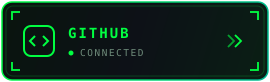

  <!-- 1. Top Terminal Bar -->
  

    

  <!-- 2. Hero Identity Card (Yuda) -->
  

    

  <!-- 3. Custom Skills SVG Card -->
  

    

  <!-- 4. Connect / Uplink Section -->
  

  

    
    &nbsp;&nbsp;
    
  

