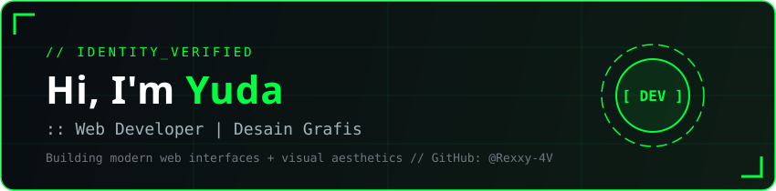

  <!-- 1. Top Terminal Bar -->
  

    

  <!-- 2. Hero Identity Card (Yuda) -->
  

    

  <!-- 3. Social Media Bar dengan Bracket Kiri & Kanan -->
  

    
    &nbsp;
    
    &nbsp;
    
    &nbsp;
    
    &nbsp;
    
    &nbsp;
    
  

   

  <!-- 4. Custom Skills SVG Card -->
  

    

  <!-- 5. GitHub Stats & Streak (Tema Hijau Cyber) -->
  <table>
    <tr>
      <td align="center" width="50%">
        
      </td>
      <td align="center" width="50%">
        
      </td>
    </tr>
  </table>

   

  <!-- 6. Most Used Languages -->
  

    

  <!-- 7. Pacman Contribution Game -->
  <h3><code>&gt;_ FUN_GAME.EXE</code></h3>
  <picture>
    <source media="(prefers-color-scheme: dark)" srcset="https://raw.githubusercontent.com/rexxy-4v/rexxy-4v/output/pacman-contribution-graph-dark.svg">
    <source media="(prefers-color-scheme: light)" srcset="https://raw.githubusercontent.com/rexxy-4v/rexxy-4v/output/pacman-contribution-graph.svg">
    
  </picture>

